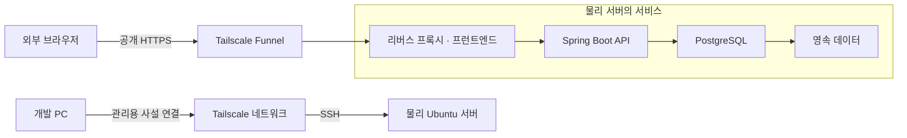

## 1. 들어가며 — 애플리케이션 실행 다음의 문제

Java 백엔드를 로컬에서 실행하는 것과 서버에서 계속 운영하는 것은 다른 일이었다. IDE에서 Spring Boot가 실행돼도 다른 기기에서 접속하는 경로, DB 데이터를 보관하는 위치, 재시작과 배포 실패 시 복구 방법은 별도로 정해야 했다.

나는 Windows Pro의 Hyper-V에 Ubuntu Server를 설치하고 Docker로 PostgreSQL과 Spring Boot를 실행하는 환경을 구축했다. 이후에는 Ubuntu를 물리 서버에 직접 설치하는 구조로 옮겼다. 이 시리즈는 그 과정을 Linux·네트워크·컨테이너·배포가 어떻게 연결되는지 설명하는 기록으로 정리한다.

**이번 1편은 전체 구조와 검증 기준을 정한다.** 실제 설치 명령과 장애 분석은 해당 단계의 글에서 다룬다. 이 글의 날짜는 회고 작성일이며 최초 OS 설치일을 의미하지 않는다.

## 2. 구현 목표와 10편의 로드맵

목표는 명령어를 따라 실행하는 데서 끝내지 않고, 문제가 생겼을 때 어느 계층부터 확인할지 설명할 수 있는 환경을 만드는 것이다.

| 편 | 주제 | 학습 목표와 완료 기준 |
| --- | --- | --- |
| [1 편](/blog/home-server-architecture-hyper-v-ubuntu-docker) | 홈서버 목적과 아키텍처 | 개발 PC·게스트 OS·컨테이너·DB의 역할과 통신 경로를 구분한다. |
| [2 편](/blog/home-server-hyper-v-ubuntu-install) | Hyper-V와 Ubuntu 설치 | 가상화 지원, VM 자원, 설치 옵션을 확인하고 OS·커널 정보를 기록한다. |
| [3 편](/blog/home-server-hyper-v-nat-static-ip) | Virtual Switch·고정 IP·NAT | 호스트와 VM의 통신, 게이트웨이와 외부 통신 경로를 설명하고 단계별로 검사한다. |
| [4 편](/blog/home-server-ssh-keys-ufw) | SSH 공개키와 UFW | 키 인증을 확인한 뒤 원본 주소 제한과 방화벽을 적용하고 새 연결로 검증한다. |
| [5 편](/blog/home-server-docker-engine-compose-install) | Docker Engine·Compose 설치 | 공식 저장소로 설치하고 클라이언트·데몬·Compose 및 hello-world 동작을 구분한다. |
| [6 편](/blog/home-server-postgresql-compose-volumes-roles) | PostgreSQL 컨테이너 | 볼륨·네트워크·healthcheck와 DB·스키마·역할을 구성하고 접속·권한을 검사한다. |
| [7 편](/blog/home-server-java17-spring-boot-docker-build) | Java 17·Spring Boot 이미지 | InvenCore의 Gradle bootJar와 멀티스테이지 이미지를 확인하고 앱·DB 연결을 검증한다. |
| [8 편](/blog/home-server-compose-operations-backup-rollback) | Compose 운영과 복구 | 상태·로그·재시작·백업·롤백을 구분하고 실제 스크립트의 보호 범위를 확인한다. |
| [9 편](/blog/home-server-tailscale-funnel-access) | Tailscale·Funnel 외부 접속 | 관리용 사설 연결과 공개 HTTPS 경로를 나누고 각각 접근을 확인한다. |
| [10 편](/blog/home-server-github-actions-cicd) | GitHub Actions CI/CD | 테스트·이미지 게시·배포·운영 검증을 분리하고 스키마 호환성과 실패 대응을 설명한다. |

물리 서버 이전은 10편 이후 후속 회고로 다룬다. 이전 사실은 여기서 소개하지만 새 서버의 주소와 설정을 초기 VM 설치 절차에 끼워 넣지 않는다.

## 3. 사전 지식 — Hyper-V와 Docker는 서로 다른 계층이다

Hyper-V는 가상 하드웨어와 게스트 운영체제를 제공한다. Windows는 관리 역할을 하는 루트 파티션에서 동작하고 Ubuntu는 게스트로 실행된다. 일반 프로그램 하나 안에 Linux 프로세스만 띄우는 구조로 이해하면 OS와 네트워크 경계가 흐려진다. [Microsoft의 Hyper-V 아키텍처](https://learn.microsoft.com/en-us/windows-server/virtualization/hyper-v/architecture)에 설명된 계층이다.

Docker 컨테이너는 애플리케이션 실행 환경을 분리하면서 호스트의 커널을 공유한다. **이 구성에서 Linux 컨테이너가 공유하는 것은 Ubuntu VM의 Linux 커널이다. Windows 커널을 직접 공유하는 것이 아니다.** 가상머신과 컨테이너를 함께 사용한 이유를 이해하는 출발점이다. [Docker의 컨테이너 설명](https://docs.docker.com/learn/content/what-is-a-container/)을 기준으로 구별했다.

이미지는 실행에 필요한 파일과 설정의 기반이고 컨테이너는 그 이미지를 실행한 인스턴스다. Compose는 여러 서비스와 네트워크·볼륨을 선언해 애플리케이션 구성을 관리한다. 파일 하나를 작성했다고 데이터 백업과 장애 복구까지 자동으로 해결되는 것은 아니다. [Compose 애플리케이션 모델](https://docs.docker.com/compose/intro/compose-application-model/)도 이 역할 구분의 기준으로 삼았다.

## 4. 현재 환경 — 초기 구축과 이후 확장을 분리하기

| 항목 | 초기 가상머신 환경 | 이후 물리 서버 환경 |
| --- | --- | --- |
| 개발 PC | Windows Pro, 호스트 RAM 32GB | 개발과 원격 관리 역할 |
| 서버 OS | Hyper-V 안의 Ubuntu Server 24.04 LTS | 하드웨어에 직접 설치한 Ubuntu Server |
| 네트워크 | Internal Switch와 Windows NAT, VM 고정 주소 | 물리 LAN과 Tailscale 연결 |
| 앱 실행 | Ubuntu 안의 Docker·Compose | 물리 Ubuntu 안의 Docker·Compose |
| 주요 흐름 | 초기 InvenCore, Gradle·Java 17 | 이후 슬개기술연구소, Maven·Java 17 및 React·Phaser |

제공된 설치 메모에는 Ubuntu 24.04.5 LTS, 이후 서버 점검값에는 Docker Engine 29.9.3과 Compose v5.7.1이 적혀 있다. **각각 기록 당시 값이며 현재 최신 버전이라는 뜻이 아니다.** 설치 당시 ISO의 정확한 파일명과 출력은 이번 자료에 없어 다음 설치 편에서 확인 필요 항목으로 남긴다.

호스트 RAM 32GB를 VM 할당 메모리로 바꿔 쓰지 않는다. 초기 VM의 생성 당시 CPU·RAM·디스크 지정값도 제공 자료만으로 확정하지 않는다. 실제 IP·호스트명·DB 계정·개인 파일 경로는 공개 글에서 제외했다.

## 5. 구축 과정 — 통신 경로와 데이터 위치를 먼저 그리기

### 초기 VM의 역할 배치

아래는 초기 핵심 구조를 단순화한 그림이다. 모든 서비스를 처음부터 동시에 구성했다는 타임라인을 뜻하지 않는다.

```mermaid
flowchart TB
    subgraph HOST[Windows Pro 개발 PC]
        DEV[IDE · Git · SSH 클라이언트]
        SWITCH[Hyper-V Internal Switch]
        GATEWAY[Windows 가상 어댑터 · 게이트웨이]
        NAT[Windows NAT]
        subgraph VM[Ubuntu Server 가상머신]
            VNIC[Ubuntu 가상 네트워크 어댑터]
            SSHD[SSH 서버]
            ENGINE[Docker Engine]
            APP[InvenCore Spring Boot 컨테이너]
            DB[PostgreSQL 컨테이너]
            DATA[DB 영속 저장 영역]
            ENGINE --> APP
            ENGINE --> DB
            APP -->|Docker 네트워크| DB
            DB --> DATA
        end
        DEV -->|SSH 관리 연결| SWITCH
        SWITCH --> SSHD
        VNIC --> SWITCH
        SWITCH --> GATEWAY
        GATEWAY -->|외부로 나가는 통신| NAT
    end
    NAT --> INTERNET[인터넷 · 패키지 및 이미지 저장소]
```



Internal Switch는 호스트와 같은 호스트의 VM 사이 통신을 제공한다. 스위치만 만들었다고 VM의 인터넷 연결이 생기는 것은 아니다. 이 구성에서는 Windows NAT와 게이트웨이 설정을 함께 사용했다. 외부 기기에서 VM으로 들어오는 접속도 NAT가 자동으로 모두 허용하지는 않는다. [Hyper-V 가상 스위치 종류](https://learn.microsoft.com/en-us/windows-server/virtualization/hyper-v/features-terminology#virtual-switch)와 구별해 3편에서 설명한다.

각 기술의 책임은 다음과 같다.

| 구성 | 이 환경에서 맡은 일 |
| --- | --- |
| Windows 개발 PC | 코드 작성·Git 작업·SSH 접속과 초기 VM 관리 |
| Ubuntu | SSH·네트워크·방화벽·Docker 데몬이 실행되는 서버 OS |
| Docker Engine | 이미지와 컨테이너의 실행·격리·네트워크 관리 |
| Compose | 서비스·볼륨·네트워크·설정 연결을 선언 |
| PostgreSQL | 데이터 저장과 역할·권한 관리 |
| Java 17·Spring Boot | 요청 처리와 DB 접근을 수행하는 애플리케이션 |
| SSH·UFW | 관리 접속 인증과 호스트 접근 정책 |

DB 데이터는 컨테이너의 일시적인 쓰기 계층에만 의존하지 않도록 별도 영속 저장소로 관리하는 것이 설계 기준이다. 볼륨의 실제 연결 위치, 재생성 후 보존과 백업 복원은 6·8편에서 따로 검증한다.

### 물리 서버로 확장한 뒤의 접근 경로



관리용 Tailscale 연결과 Funnel의 공개 경로를 나눴다. Funnel은 tailnet 사용자만 보는 사설 접속이 아니라 외부 인터넷에 서비스를 공개하는 기능이다. HTTPS가 적용됐다고 서비스의 로그인·관리자 권한까지 대신해 주지는 않는다. [Tailscale Funnel 공식 설명](https://tailscale.com/docs/features/tailscale-funnel)을 기준으로 접근 범위를 구분했다.

후속 환경에는 Redis·Kafka 활용도 포함되지만 이 그림은 HTTP와 DB의 기본 경로에 집중했다. 두 프로젝트의 구체적인 연결과 도입 시점은 각각의 소스·운영 기록을 확인해 설명한다.

## 6. 트러블슈팅 — 설치를 다시 한 사실과 원인을 구분하기

제공한 기록에는 Ubuntu 재설치, 초기 네트워크 장애, SSH 연결 실패와 공개키 접속 성공이 있다. 그러나 모든 단계의 오류 메시지와 수정 전후 설정까지 있는 것은 아니다. 따라서 초기 접속 실패를 게이트웨이 오류나 UFW 규칙 탓이라고 미리 확정하지 않는다.

이후 남겨 둔 별도의 운영 기록에서는 SSH 키를 서버가 수락했지만 패스프레이즈가 있는 개인키를 비대화형 연결에서 쓰지 못한 사례가 확인된다. Windows ssh-agent에 키를 등록한 뒤 연결했고, 그다음에는 Docker 소켓 권한을 따로 해결했다. 이것은 **서버에 도달하지 못하는 네트워크 장애와는 다른 원인**이다. 초기 설치 때의 모든 SSH 실패가 같은 문제였다고 묶지 않는다.

원인 분석은 다음 순서로 정리할 계획이다.

1. 호스트와 게스트의 연결 경로가 있는지 확인한다.
2. SSH 서비스에 도달하는지와 인증이 가능한지를 나눈다.
3. 로그인 후 Docker 데몬 접근 권한을 확인한다.
4. 컨테이너 실행·앱 응답·DB 연결을 각각 검사한다.

해당 사례의 기존 기록은 [서버 격리와 개발 DB 연결 글](/blog/seulgae-tech-lab-isolated-server-and-development-db)에 남아 있다. 실제 키·주소·계정과 원문 인증 로그는 재게시하지 않는다.

## 7. 기술적 이해 — 홈서버를 선택하며 얻는 것과 맡게 되는 것

이미 있는 Windows Pro와 하드웨어에서 VM을 먼저 구성하면 개발 PC를 유지하며 별도 Linux 환경의 설치와 네트워크를 직접 관찰할 수 있다. 이 점은 OS부터 앱까지 이해하려는 학습·포트폴리오 목적과 맞았다. Ubuntu Server LTS의 설치와 운영 문서는 단계별 확인 기준으로 활용했다. [Ubuntu 기본 설치 문서](https://ubuntu.com/server/docs/tutorial/basic-installation/)는 다음 편의 절차를 대조할 기준이다.

클라우드가 관리하는 경계까지 직접 다루는 대신 전원·장비·공유기·백업·원격 복구도 운영자의 책임이 된다. 초기 VM은 Windows 호스트의 종료·재부팅에도 영향을 받는다. 물리 서버로 나누면 개발 PC와 실행 장비의 경계는 달라지지만 장비 장애나 데이터 백업의 책임이 없어지지는 않는다.

이번 자료에는 클라우드 요금 비교, 전력 측정, 가용률이나 성능 전후 수치가 없다. 홈서버가 더 싸거나 빠르다는 성과로 쓰지 않는다. 이 시리즈에서 설명할 수 있는 것은 **내가 구성한 실행 경로와 확인한 결과**다.

## 8. 최종 검증 — 출력은 재현용 예시와 실제 결과를 나누기

아래는 환경을 다시 확인할 때 사용할 조회 명령이다. 이번 글 작성 중 서버에서 실행한 명령이나 당시 전체 실행 로그가 아니다.

```bash
cat /etc/os-release
uname -r
docker version
docker compose version
```

`os-release`는 배포판 정보, `uname -r`은 실행 중인 커널을 확인한다. `docker version`은 클라이언트와 연결된 서버 정보를 나눠 보여 주며 데몬 접속이 실패할 수도 있다. `docker compose version`은 Compose 도구 버전이다. 버전 출력 하나로 앱과 DB의 정상 동작까지 확인했다고 말하지 않는다.

다음 체크리스트는 현재 모두 통과했다는 보고가 아니라 각 단계에서 확보할 증거다.

- [ ] 호스트·게스트·물리 서버의 OS와 자원 정보를 시기별로 기록한다.
- [ ] VM 고정 주소·게이트웨이·NAT·DNS를 따로 확인한다.
- [ ] SSH 키 인증과 원본 접근 제한을 새 세션에서 검증한다.
- [ ] Docker 데몬 접근, 컨테이너 실행·로그·healthcheck를 구분한다.
- [ ] 앱의 실제 요청·DB 연결·권한 제한을 확인한다.
- [ ] 데이터 보존·백업 복원·배포 실패 복구의 결과를 따로 남긴다.

이번에는 제공된 경험과 기존 운영 글, InvenCore의 `backend/build.gradle`·`backend/Dockerfile`을 대조했다. 확인한 소스는 Java 17·Gradle bootJar·JDK 빌드/JRE 실행 단계이며 최초 설치 당시 전체 설정을 재현한 것은 아니다. 운영 서버 접속·재설치·컨테이너 변경은 수행하지 않았다.

## 9. 회고

서버를 이해한다는 것은 설치된 기술 이름을 기억하는 것보다, 요청이 어디를 지나고 데이터가 어디에 남는지 설명하는 데 가까웠다.

가상머신은 OS 실행 환경을 나누고 컨테이너는 그 안의 앱 실행 환경을 나눈다. 이 구분이 있어야 네트워크 문제와 인증 문제, 앱 문제를 순서대로 좁힐 수 있다.

다시 구축한다면 설치 직후 정보와 명령 결과부터 남기고, 변경 이유와 검증 근거를 같은 기록에 연결하겠다. 설명할 수 없는 옵션을 그대로 복사하기보다 어떤 계층을 바꾸는 설정인지 먼저 확인하는 것이 이번 시리즈의 기준이다.

## 10. 다음 편 — Windows Hyper-V에 Ubuntu Server 설치하기

2편에서는 가상화 지원과 Hyper-V 활성화, ISO·VM 생성·디스크·메모리와 설치 옵션을 다룬다. 확인된 실제 선택과 재현용 예시를 나눠 설명하고 OS·커널 조회 및 패키지 갱신의 의미까지 연결한다. 생성 당시 자원 지정값과 설치 화면 기록이 없는 부분은 임의로 채우지 않는다.

---

[전체 목차](/blog/home-server-architecture-hyper-v-ubuntu-docker) · [다음 글](/blog/home-server-hyper-v-ubuntu-install)

