## 1. 들어가며

[9편](/blog/home-server-tailscale-funnel-access)에서 관리망과 공개 웹 경로를 나눴다. 이제 새 코드를 어떤 기준으로 서버에 전달할지 정해야 한다. GitHub Actions에서 빌드가 성공했다는 사실과 서버에서 그 코드가 정상 동작한다는 사실은 서로 다르다.

내 저장소에는 초기 InvenCore와 이후 슬개기술연구소의 배포 코드가 남아 있다. 둘 다 Java 17을 사용하지만 빌드 도구와 복구 동작은 같지 않다. 이 글은 실제 파일을 기준으로 공통 흐름을 설명하고 프로젝트별 차이를 남긴다.

## 2. 구현 목표

목표는 테스트한 커밋과 게시한 이미지, 서버의 Compose 설정이 같은 릴리스를 가리키게 만드는 것이다. DB 변경은 앱 교체와 별도로 검토하고, 배포 실패 시 되돌릴 수 있는 범위를 명시한다.

이 글을 작성하면서 Actions를 실행하거나 서버에 접속하지 않았다. 아래의 로컬 명령도 재현 방법이며 이번 집필 과정의 테스트 결과가 아니다. 현재 저장소 변수의 값과 운영 배포 활성화 여부는 확인하지 못했다.

## 3. 사전 지식

CI는 변경을 검사하고 실행 가능한 결과물을 만드는 과정이다. 배포 단계는 그 결과물을 대상 환경에 적용한다. GitHub Actions는 push·pull request·수동 실행 등의 이벤트와 job 조건으로 이를 분리할 수 있다. [공식 워크플로 트리거 안내](https://docs.github.com/en/actions/how-tos/write-workflows/choose-when-workflows-run/trigger-a-workflow)를 참고했다.

이미지 태그는 사람이 읽기 쉽지만 다시 가리킬 수 있다. digest는 이미지 내용을 식별한다. 따라서 서버에서 이미지를 다시 빌드하기보다 CI가 검증하고 게시한 digest를 가져오면 배포 대상의 모호함을 줄일 수 있다. 이것만으로 외부 설정과 데이터 상태까지 동일해지는 것은 아니다.

## 4. 현재 환경

| 대상 | 확인한 빌드·배포 파일 | 구분할 점 |
| --- | --- | --- |
| InvenCore | `backend/build.gradle`, `.github/workflows/docker-publish.yml`, `deployment/docker/deploy.py` | Gradle 기반이며 배포 실패 시 자동 롤백을 보장하지 않는다. |
| 슬개기술연구소 | `backend/pom.xml`, `.github/workflows/ci.yml`, `.github/workflows/deploy.yml`, `deploy/ops.py` | Maven 기반이며 릴리스 manifest와 앱 상태 기록으로 교체·복구한다. |

확인한 슬개기술연구소 소스는 프런트엔드·백엔드·운영 도구 검증을 분리한다. PostgreSQL을 사용하는 CI 검증은 폐기 가능한 테스트 DB에서 수행한다. CI 계정과 실제 운영 계정은 같은 대상으로 취급하면 안 된다.

## 5. 구축 과정

### 로컬 검사와 CI 검사를 연결하기

다음은 각 프로젝트 루트에서 실행할 수 있는 명령 예시다. 빌드에 필요한 Java·Node·Docker 및 테스트 환경을 먼저 준비해야 한다.

```bash
# InvenCore 루트: Gradle 백엔드
(cd backend && ./gradlew --no-daemon test bootJar)

# 슬개기술연구소 루트: Maven 백엔드
(cd backend && mvn -B verify)

# 슬개기술연구소 루트: 프런트엔드
(cd frontend && npm ci && npm run build)

# 슬개기술연구소 루트: 운영 도구 단위 테스트
python3 -m unittest discover -s deploy -p 'test_*.py' -v
```

위 블록의 두 프로젝트 명령을 하나의 저장소에서 전부 실행하는 것은 아니다. `npm ci`는 lock 파일을 기준으로 의존성을 설치하고, `bootJar`는 실행 가능한 Spring Boot 아카이브를 만든다. 일부 통합 테스트는 Docker나 별도 환경변수를 요구하므로 종료 코드와 실패한 테스트를 읽어야 한다. 빌드 명령을 적었다는 이유로 검증 완료로 기록하지 않는다.

### 검사와 이미지 게시를 분리하기

슬개기술연구소 CI의 게시 job에는 다음 조건이 있다. 실제 소스에서 필요한 부분만 발췌했다.

```yaml
publish:
  needs: [frontend, backend, operations]
  if: github.ref == 'refs/heads/main' && github.event_name != 'pull_request'
```

앞선 세 검사가 성공해야 게시 단계가 진행된다. PR 검증 성공이 곧 운영 이미지 게시를 의미하지 않는다. 서버에서는 성공한 main CI와 연결된 릴리스를 선택하고, 그 안의 이미지 정보를 검증한다.

### 릴리스에 코드와 이미지·스키마 정보를 묶기

확인한 CI는 `release.json`에 커밋 SHA, workflow run ID, 프런트엔드·백엔드 이미지 digest, 지원 DB 스키마 범위를 기록한다. 아래 구조는 필드의 역할을 설명한 것이며 실제 운영 값이나 완전한 manifest 예시는 아니다.

| 정보 | 배포에서 사용하는 이유 |
| --- | --- |
| 커밋 SHA | Compose와 운영 도구가 어떤 코드인지 고정한다. |
| CI run ID | 어떤 검사를 통과한 결과물인지 연결한다. |
| 서비스별 이미지 digest | 서버가 가져올 이미지 내용을 고정한다. |
| 지원 스키마 범위 | 현재 DB에서 실행 가능한 앱인지 먼저 판단한다. |

```mermaid
flowchart LR
    Change[코드 변경] --> Checks[프런트엔드·백엔드·운영 검사]
    Checks --> Publish[main 이미지 게시]
    Publish --> Manifest[릴리스 manifest]
    Manifest --> Gate[배포 활성화·대상 조건]
    Gate --> SSH[Tailscale 경유 SSH]
    SSH --> Ops[공통 배포 도구]
    Ops --> Verify[이미지·상태·DB 호환 검사]
    Verify --> Replace[앱 컨테이너 교체]
    Replace --> Health[상태 검증·기록]
```



### 배포 실행 조건과 비밀 정보를 따로 관리하기

배포 workflow는 CI 완료 이벤트를 받지만 성공 여부·main 브랜치·저장소 일치·PR 제외·배포 활성화·배포 대상 조건을 추가 검사한다. `DEPLOY_ENABLED`는 코드에 있는 조건 이름이며 현재 값이 true라는 뜻은 아니다.

SSH 개인키와 known_hosts는 별도 secret으로 주입하고, 확인한 코드는 `BatchMode=yes`와 `StrictHostKeyChecking=yes`를 사용한다. 접속 실패를 피하려고 호스트 키 검사를 끄는 방식은 선택하지 않았다. 자격 증명은 필요한 workflow에만 전달하고 최소 권한으로 제한한다. [GitHub의 secret 설명](https://docs.github.com/en/actions/concepts/security/secrets)을 기준으로 점검할 부분이다.

## 6. 트러블슈팅

### 이미지는 새것인데 서버의 Compose는 예전 파일이었다

개발 로그에는 새 이미지가 게시되어도 서버 저장소가 이전 커밋에 머물러 설정이 어긋날 수 있었던 문제가 있다. 확인한 `sync_checkout()`은 릴리스 커밋으로 서버 checkout을 맞추고, 추적 파일에 로컬 변경이 있으면 중단한다. 이력과 작업 파일을 강제로 덮어써서 진행하지 않는다.

이후 해당 릴리스의 운영 도구로 다시 실행하는 흐름을 갖는다. 이미지 버전만 맞추는 것보다 Compose·검증 코드까지 같은 기준으로 묶는 이유다. 구체적인 서버 경로는 공개 글에서 제외했다.

### 앱을 되돌리면 DB도 되돌아가는가

슬개기술연구소 `ops.py`는 업데이트 실패 시 이전 앱을 한 번 복원한다. 첫 배포는 이전 앱이 없으므로 후보 앱 컨테이너만 정리한다. 이 과정이 DB의 과거 상태 복원을 의미하지 않는다.

확인한 운영 구성은 일반 앱 배포에서 SQL 초기화와 Flyway 자동 실행을 끈다. `migrate-prod.py`는 별도 진입점에서 백업과 스키마 호환성을 검사한다. 실패했다고 DB를 자동으로 과거 덤프로 덮어쓰지 않는다. 반면 InvenCore의 실제 설정에는 JPA 스키마 갱신과 일부 기능의 DDL 요구가 있어 같은 정책이 이미 적용됐다고 표현할 수 없다. 두 프로젝트의 차이는 [7편](/blog/home-server-java17-spring-boot-docker-build)과 [8편](/blog/home-server-compose-operations-backup-rollback)에서 다뤘다.

## 7. 기술적 이해

이 구조에서 중요한 단위는 최신 이미지 한 개보다 검증 가능한 릴리스다. 앱 코드가 새 컬럼을 사용한다면 이미지 digest가 정확해도 DB 준비가 안 된 상태에서는 실패한다. 먼저 이전 앱과 새 앱이 모두 견딜 수 있는 스키마 확장을 적용하고, 데이터 이동과 코드 사용을 분리하는 방식이 필요한 이유다.

배포 동시 실행도 같은 상태를 바꾸는 경쟁 문제다. 확인한 배포 workflow는 concurrency 그룹을 두고 실행 중인 배포를 새 실행으로 취소하지 않는다. 이것이 모든 장애를 막지는 않지만 교체와 복구가 서로 끼어드는 상황을 줄이는 장치가 된다.

## 8. 최종 검증

- [ ] 로컬 검사와 CI의 실제 종료 결과를 확인한다.
- [ ] PR 검사와 main 이미지 게시 결과를 구분한다.
- [ ] 릴리스 커밋·run ID·이미지 digest를 대조한다.
- [ ] 현재 DB 버전이 후보 앱과 복구 앱의 지원 범위인지 확인한다.
- [ ] 배포 활성화 값과 대상 서버를 실제 저장소 설정에서 확인한다.
- [ ] 첫 배포와 업데이트 실패 시 복구 동작을 각각 검증한다.
- [ ] 교체 후 HTTP·API·WebSocket 및 서비스 기능을 별도로 확인한다.

이번 글에서 확인한 것은 파일에 구현된 흐름과 기존 개발 기록이다. 위 체크리스트를 현재 운영 환경에서 다시 실행한 결과는 확인하지 못했다. CI 성공, 배포 성공, 사용자 기능 성공을 하나의 결과로 합치지 않는다.

## 9. 회고

자동화의 가치는 실행 횟수를 줄이는 데서 끝나지 않았다. 어느 커밋이 어떤 검사를 통과했고, 어떤 이미지와 설정으로 실행되는지 추적할 수 있어야 실패도 설명할 수 있다. Java 개발자로서는 앱의 정상 기동 외에 스키마 호환성·배포 순서·복구 범위를 코드의 일부처럼 다루는 관점이 필요했다.

## 10. 다음 편

10편으로 초기 홈서버 구성에서 자동 배포까지의 연결을 정리했다. [후속편](/blog/home-server-vm-to-physical-ubuntu-migration)에서는 Hyper-V의 Ubuntu를 물리 Ubuntu 서버로 옮길 때 달라진 전제와 최초 배포 문제를 다룬다. 실제 이전 기록이 없는 부분은 재현 계획과 분리한다.

---

[전체 목차](/blog/home-server-architecture-hyper-v-ubuntu-docker) · [이전 글](/blog/home-server-tailscale-funnel-access) · [다음 글](/blog/home-server-vm-to-physical-ubuntu-migration)

