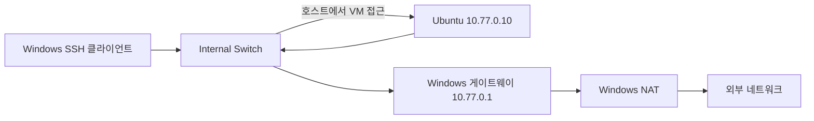

## 1. 들어가며

[2편](/blog/home-server-hyper-v-ubuntu-install)에서 Ubuntu가 부팅되는 단계까지 다뤘다. 하지만 VM이 켜졌다는 사실은 인터넷과 SSH 연결의 성공을 뜻하지 않는다. 초기 구축에서는 Internal Switch와 고정 IP, Windows NAT를 사용했고 네트워크 연결 문제도 겪었다. 이번에는 그 구조를 재현 가능한 예시로 나눠 본다.

## 2. 구현 목표

Windows에서 VM에 접근하는 경로와 Ubuntu가 외부로 나가는 경로를 모두 설명하는 것이 목표다. 원격 장비가 VM으로 바로 들어오는 경로는 별개다. NAT만 만들고 모든 방향의 접속이 가능하다고 판단하지 않는다.

## 3. 사전 지식

IP는 인터페이스의 주소, 서브넷은 직접 통신할 범위, 게이트웨이는 다른 네트워크로 보낼 다음 경로다. `/24`는 IPv4 주소의 앞 24비트를 네트워크 구분에 쓴다. 고정 IP는 운영자가 이 값을 지정하고 DHCP는 서버로부터 임대받는다.

Hyper-V 스위치도 용도가 다르다.

| 종류 | 통신 범위와 이 글의 판단 |
| --- | --- |
| Default Switch | Windows가 관리하는 기본 NAT 환경; 수동 Internal Switch와 구분 |
| Internal | 호스트와 같은 호스트의 VM 사이 연결; 별도 NAT·주소 설정 필요 |
| External | VM을 외부 물리 네트워크에 연결; LAN의 DHCP·정책 영향 |
| Private | 같은 호스트의 VM끼리만 연결 |

Internal Switch에 DHCP가 자동 제공된다고 가정하지 않는다. 아래 수동 NAT 예시는 Ubuntu 주소도 직접 지정한다. [Microsoft NAT 가이드](https://learn.microsoft.com/en-us/windows-server/virtualization/hyper-v/setup-nat-network)의 전제와 같다.

## 4. 현재 환경과 공개용 값

실제 초기 기록은 Windows Pro·Hyper-V·Internal Switch·고정 주소·NAT 구성이다. 공개 글의 아래 값은 실제 주소와 스위치명을 바꾼 **실습 예시**다.

| 대상 | 공개용 예시 |
| --- | --- |
| 사설 대역 | `10.77.0.0/24` |
| Windows 내부 가상 어댑터 | `10.77.0.1` |
| Ubuntu | `10.77.0.10/24` |
| Ubuntu 기본 게이트웨이 | `10.77.0.1` |
| 스위치 이름 | `LabNatExample` |

자신의 LAN·VPN·Docker·기존 NAT와 겹치지 않는지 먼저 확인한다. 이 예시는 물리 서버로 이전한 뒤의 LAN 주소가 아니다.

## 5. 구축 과정



### 먼저 기존 Windows 구성을 조회하기

관리자 PowerShell의 **조회 예시**다.

```powershell
Get-VMSwitch
Get-NetNat
Get-NetIPAddress -AddressFamily IPv4
```

공식 NAT 가이드는 단일 NAT 환경을 전제로 한다. 기존 가상화 도구가 만든 NAT가 있으면 같은 절차를 그대로 추가하지 않는다. 기존 NAT를 통째로 삭제해 문제를 덮는 방법도 쓰지 않는다.

### 내부 스위치·게이트웨이·NAT 만들기

아래는 충돌이 없고 해당 이름의 스위치가 없는 **새 실습 환경**에 대한 설정 예시다.

```powershell
New-VMSwitch -Name 'LabNatExample' -SwitchType Internal
$labNatAdapter = Get-NetAdapter -Name 'vEthernet (LabNatExample)'
New-NetIPAddress -InterfaceIndex $labNatAdapter.ifIndex -IPAddress 10.77.0.1 -PrefixLength 24
New-NetNat -Name 'LabNatExample' -InternalIPInterfaceAddressPrefix '10.77.0.0/24'
```

첫 명령은 스위치를 만든다. 다음은 Windows 쪽 가상 어댑터에 게이트웨이 주소를 주고, 마지막은 이 내부 대역에서 나오는 트래픽의 주소 변환을 설정한다. VM의 네트워크 어댑터도 Hyper-V 관리자에서 같은 스위치에 연결해야 한다.

### Ubuntu의 주소·기본 경로·DNS 설정

콘솔에서 `ip -br link`, `ip -br address`, `ip route`와 기존 `/etc/netplan/`의 파일을 확인한다. 인터페이스 이름은 아래의 `eth0`과 다를 수 있다. 기존 설정을 백업하고 어떤 파일이 같은 인터페이스를 정의하는지부터 확인한다. 서로 충돌하는 YAML을 계속 추가하지 않는다.

아래는 **Netplan 재현용 설정**이다.

```yaml
network:
  version: 2
  renderer: networkd
  ethernets:
    eth0:
      dhcp4: false
      addresses: [10.77.0.10/24]
      routes:
        - to: default
          via: 10.77.0.1
      nameservers:
        addresses: [1.1.1.1, 9.9.9.9]
```

DNS 주소는 공개 리졸버 예시이며 네트워크 정책에 맞게 정한다. NAT를 만든 Windows 주소가 곧 DNS 서버라는 뜻은 아니다. cloud-init이 관리하는 파일인지도 확인하고 재부팅 시 재생성되는 설정을 임의로 덮어쓰지 않는다. [Ubuntu 네트워크 설정 문서](https://ubuntu.com/server/docs/configuring-networks/)를 기준으로 작성했다.

### 검사 후 되돌릴 수 있는 방식으로 적용하기

파일 권한을 관리하고 Hyper-V 콘솔을 유지한 상태에서 다음을 실행한다.

```bash
sudo netplan generate
sudo netplan try --timeout 120
ip -br address
ip route
getent hosts archive.ubuntu.com
```

`generate`는 설정 변환 과정의 오류를 검사하고 `try`는 확인 시간 안에 승인하지 않으면 되돌리려는 임시 적용 기능이다. 다만 모든 복구 상황을 보장하지 않으므로 타임아웃 뒤에도 실제 주소·경로와 복원 여부를 확인한다. 이는 [Netplan try 문서](https://netplan.readthedocs.io/en/stable/netplan-try/)에 명시된 주의점이다.

## 6. 트러블슈팅 — SSH 실패를 바로 방화벽 탓으로 돌리지 않기

초기 네트워크와 SSH 장애를 겪었지만 모든 오류 출력은 남아 있지 않다. 다음은 확정한 당시 원인 대신, 다시 진단할 때 사용할 순서다.

| 관측 | 다음 확인 |
| --- | --- |
| Ubuntu에 예상 주소가 없음 | VM 스위치 연결·인터페이스명·Netplan 적용 결과 |
| 호스트와 VM 사이 접근 실패 | 같은 서브넷·경로·호스트/게스트 방화벽 |
| 내부 통신은 되지만 외부 통신 실패 | 기본 게이트웨이·Windows NAT·상위 연결 |
| 외부 주소 연결은 되지만 도메인 실패 | DNS 설정과 이름 조회 |
| SSH 포트는 열리지만 로그인 실패 | 사용자·공개키·에이전트·SSH 정책 |

Windows의 `Test-NetConnection 10.77.0.10 -Port 22`는 SSH 서버가 준비된 뒤 사용한다. ICMP 응답이 없다는 이유만으로 TCP까지 단절됐다고 확정하지 않는다. 외부에서 이 주소로 접속하는 문제는 별도의 라우팅·사설 접속 구성이 필요하다.

## 7. 기술적 이해

호스트→VM SSH는 내부 스위치 구간의 통신이다. VM→인터넷은 기본 경로와 NAT가 필요하다. 외부→VM의 신규 접속은 기존 연결의 응답 트래픽과 다르다. 세 흐름을 한 번의 ping으로 모두 검증할 수 없었다.

## 8. 최종 검증

- [ ] Windows와 Ubuntu가 같은 스위치·대역을 사용한다.
- [ ] 기본 경로와 DNS를 각각 확인한다.
- [ ] 주소 접근과 도메인 조회를 나눠 검사한다.
- [ ] 설정 적용 뒤와 재부팅 뒤 결과를 비교한다.
- [ ] 복구용 콘솔과 변경 전 설정을 확보한다.

이번 글의 주소·명령은 재현용이며 실제 서버에 적용하지 않았다. 초기 장애의 정확한 수정 전후 값은 **확인하지 못함**이다.

## 9. 회고

고정 IP만 지정하면 네트워크 구성이 끝나는 것이 아니었다. 게이트웨이·NAT·DNS는 서로 다른 역할이고, 성공한 통신의 방향도 기록해야 했다. 다음에는 설정값과 함께 어느 출발지에서 어떤 목적지로 검증했는지 남기겠다.

## 10. 다음 편

[4편](/blog/home-server-ssh-keys-ufw)에서는 이 경로 위에 SSH 공개키 인증과 UFW 접근 정책을 올린다. 인증 실패와 네트워크 실패를 분리하고 새 연결로 정책을 검증한다.

---

[전체 목차](/blog/home-server-architecture-hyper-v-ubuntu-docker) · [이전 글](/blog/home-server-hyper-v-ubuntu-install) · [다음 글](/blog/home-server-ssh-keys-ufw)

