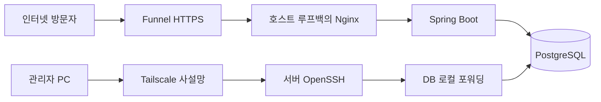

## 1. 들어가며

[8편](/blog/home-server-compose-operations-backup-rollback)까지는 서버 안에서 앱을 실행하고 복구하는 방법을 다뤘다. 다음 문제는 집 밖에서 접근하는 경로다. 관리자에게 SSH와 DB 접속이 필요하다고 해서 그 포트를 방문자에게도 공개할 필요는 없다.

내 구축 기록에는 Tailscale을 이용한 서버 관리와 Funnel을 통한 웹 서비스 공개가 함께 등장한다. 둘을 같은 접속 방식으로 이해하면 웹사이트가 열렸다는 이유만으로 관리 포트까지 안전하다고 착각하기 쉽다. 이 글에서는 접근 주체와 공개 범위를 먼저 나눈다.

## 2. 구현 목표

관리자는 승인된 사설 연결에서 SSH와 DB 터널을 사용하고, 방문자는 HTTPS 웹 진입점만 이용하도록 구성한다. PostgreSQL과 Spring Boot 포트를 각각 인터넷에 공개하는 대신, 웹 요청을 프런트엔드 Nginx로 모은다.

실제 접속 주소·기기 이름·계정은 적지 않는다. 아래 포트와 명령은 구조를 설명하는 재현용 예시다. 작성 과정에서 서버 설정을 변경하거나 공개 접속 검증을 실행하지 않았다.

## 3. 사전 지식

Tailscale의 tailnet은 승인된 기기와 접근 정책으로 구성하는 사설 네트워크다. Serve는 tailnet 안에서 서비스를 제공하고 Funnel은 로컬 서비스를 인터넷에 공개한다. Funnel을 켰다고 공개 방문자가 tailnet 인증을 거치는 것은 아니다. 공개 웹의 로그인과 권한 검사는 앱에서 별도로 책임져야 한다. [Tailscale Funnel 설명](https://tailscale.com/docs/features/tailscale-funnel)을 기준으로 구별했다.

SSH도 구분해야 한다. Tailscale 주소를 통해 기존 OpenSSH에 접속하는 것과 Tailscale SSH 기능을 활성화하는 것은 다른 구성이다. 이번 설명은 기존 공개키 인증을 유지하는 일반 SSH 연결을 기준으로 한다.

## 4. 현재 환경

슬개기술연구소의 확인한 Compose 구성은 프런트엔드의 웹 포트를 호스트 루프백에 게시하고, 백엔드와 DB는 Docker 네트워크로 연결한다. 예시에서는 웹 진입점을 `127.0.0.1:18082`로 표현한다. 이 주소는 브라우저가 실행되는 PC가 아니라 **Tailscale 데몬과 Docker가 실행되는 서버 자신**을 가리킨다.



관리용 경로와 공개 웹 경로는 목적이 다르다. DB 터널은 [6편](/blog/home-server-postgresql-compose-volumes-roles)의 로컬 바인딩 방식을 따른다.

## 5. 구축 과정

### 먼저 서버 내부에서 웹 응답을 확인하기

외부 공개 전에 서버에서 확인하는 예시다.

```bash
curl --fail --show-error --silent --head http://127.0.0.1:18082/
docker compose ps
```

첫 명령이 실패하면 먼저 포트 게시·프런트엔드 상태·Docker 네트워크를 확인한다. Funnel 설정을 반복해서 바꾸더라도 로컬 HTTP 서버가 응답하지 않는 문제는 해결되지 않는다. HEAD를 지원하지 않는 별도 API라면 해당 API의 지원 메서드로 검사해야 한다.

### 관리망 연결 확인하기

설치는 [공식 Linux 안내](https://tailscale.com/download/linux)에 따라 환경에 맞게 진행한다. 다음 명령은 이미 설치한 장치의 상태 확인과 최초 로그인 예시다.

```bash
tailscale version
sudo tailscale up
tailscale status
tailscale netcheck
```

기존 운영 장치에서는 현재 옵션과 정책을 먼저 확인한다. 로그인 성공은 모든 포트 접근 허용을 의미하지 않는다. tailnet 정책, 서버 방화벽, SSH 인증을 각각 확인해야 한다.

### Serve와 Funnel 중 공개 범위를 선택하기

다음 두 줄은 **대안**이다. 두 명령을 연달아 적용하는 설치 순서가 아니다. 기존 Serve·Funnel 상태를 먼저 읽고, 공개 범위에 맞는 하나를 선택하는 예시다.

```bash
# tailnet 내부에서만 웹 제공
sudo tailscale serve --bg http://127.0.0.1:18082

# 인터넷 공개를 결정한 경우의 대안
sudo tailscale funnel --bg --https=443 http://127.0.0.1:18082
```

Serve와 Funnel은 같은 포트에서 동시에 서로 다른 공개 범위를 유지하지 않는다. 구성 변경 전에는 `tailscale serve status`와 `tailscale funnel status`를 확인한다. Serve 사용법은 [Serve CLI 문서](https://tailscale.com/docs/reference/tailscale-cli/serve), 공개 범위는 앞의 Funnel 기능 문서에서 대조했다.

Funnel 예시의 `--bg`는 재부팅 후에도 구성이 재개되는 지속 설정이다. 공개를 중단하려면 원래 옵션에 맞춰 `sudo tailscale funnel --bg --https=443 off`처럼 해제하고 상태를 다시 확인한다. 전체 설정을 지우는 reset을 일상적인 진단 명령으로 사용하지 않는다. 옵션과 해제 문법은 [Funnel CLI 문서](https://tailscale.com/docs/reference/tailscale-cli/funnel)를 기준으로 했다.

## 6. 트러블슈팅

### 컨테이너는 healthy인데 호스트 웹 포트가 열리지 않았다

기존 작업 기록에는 프런트엔드 내부의 healthcheck는 성공하지만 호스트에서 게시 포트로 접근하지 못한 사례가 있다. 당시에는 네트워크 구성을 확인하고 프런트엔드에 외부 연결용 네트워크를 추가해 해당 서비스만 재생성한 뒤 HTTP 응답을 확인했다.

이 기록이 모든 접속 장애의 원인을 뜻하지는 않는다. 컨테이너 내부 검사와 호스트 포트 검사는 관측 위치가 다르다는 사례다. 현재 서버에서 같은 현상이 발생했다고 단정하지 않는다.

### HTTPS 화면은 열리는데 WebSocket은 실패했다

물리 서버 이전 후에는 새 주소가 WebSocket Origin 허용 목록에 없어 로비 연결이 실패한 기록이 있다. HTML 응답 성공과 WebSocket Upgrade 성공은 별도다. 확인한 `deploy/nginx.conf`에는 다음 설정이 있다.

```nginx
location = /ws/lobby {
    proxy_pass http://backend:8080;
    proxy_http_version 1.1;
    proxy_set_header Upgrade $http_upgrade;
    proxy_set_header Connection $connection_upgrade;
    proxy_set_header Host $host;
    proxy_set_header Origin $http_origin;
    # 이 발췌 뒤의 전달 헤더·타임아웃 설정은 생략했다.
}
```

이 코드는 기존 Nginx의 관련 부분을 발췌한 것으로, 독립 실행 설정이 아니다. `$connection_upgrade`를 만드는 map도 전체 설정에 필요하다. 백엔드의 정확한 Origin 목록과 프록시 설정을 함께 확인해야 하며, 장애를 피하려고 모든 Origin을 허용하는 방식은 사용하지 않는다.

## 7. 기술적 이해

HTTPS 인증서와 암호화는 전송 구간의 신뢰를 제공한다. 로그인·API 권한·WebSocket 메시지 검증까지 대신하지 않는다. 또한 Funnel의 TLS 종료 지점 이후에는 예시처럼 로컬 HTTP 프록시가 이어질 수 있다. 따라서 외부 브라우저에서 보이는 HTTPS와 앱이 내부에서 받는 HTTP를 구분해 설정한다.

전달 헤더도 같은 맥락이다. 방문자 주소를 이용해 연결을 제한한다면 어느 프록시가 헤더를 만들고 앱이 어느 경로를 신뢰하는지 정해야 한다. 클라이언트가 임의로 보낸 헤더를 실제 주소로 받아들이는 것은 별도 문제다.

## 8. 최종 검증

| 검사 위치 | 확인할 내용 | 이번 글에서의 상태 |
| --- | --- | --- |
| 서버 루프백 | Nginx HTTP 응답과 포트 게시 | 검증 방법 제시, 현재 실행하지 않음 |
| 관리자 PC | tailnet 연결, SSH 키 인증, DB 터널 | 과거 연결 기록 확인, 현재 재검증하지 않음 |
| 외부 브라우저 | 공개 HTTPS와 로그인·권한 | 현재 운영 결과 확인하지 못함 |
| Network의 WS 항목 | Upgrade 응답, Origin 거부·허용, 연결 유지 | 관련 설정 확인, 현재 연결 테스트하지 않음 |
| 접근 제어 | DB·관리 포트의 불필요한 외부 노출 여부 | 실제 정책 전체는 확인하지 못함 |

## 9. 회고

외부 접속을 열 때 가장 먼저 정리할 것은 포트 번호보다 누가 어떤 기능에 접근해야 하는가였다. 관리용 사설 연결과 방문자용 공개 웹을 나누면 장애의 확인 경로도 분명해진다. 로컬 HTTP, 사설 SSH, 공개 HTTPS, WebSocket을 각각 확인해야 같은 화면을 보고도 서로 다른 장애를 놓치지 않는다.

## 10. 다음 편

[10편](/blog/home-server-github-actions-cicd)에서는 검증한 이미지를 GitHub Actions에서 게시하고 서버의 같은 배포 도구로 전달하는 흐름을 정리한다. 자동 실행과 운영 성공을 구분하는 기준도 함께 다룬다.

---

[전체 목차](/blog/home-server-architecture-hyper-v-ubuntu-docker) · [이전 글](/blog/home-server-compose-operations-backup-rollback) · [다음 글](/blog/home-server-github-actions-cicd)

