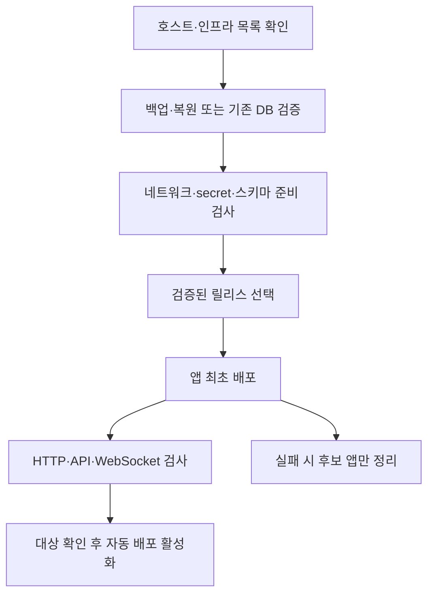

## 1. 들어가며

[1편](/blog/home-server-architecture-hyper-v-ubuntu-docker)에서 출발한 환경은 Windows Pro의 Hyper-V 안에 설치한 Ubuntu였다. 이후 기록에는 Ubuntu 24.04 물리 홈서버와 이미 실행 중인 PostgreSQL·Kafka가 등장한다. 앱 컨테이너를 처음 올리는 작업도 별도로 필요했다.

이전 사실과 새 환경의 구성은 확인할 수 있지만, 모든 데이터를 어떤 순서로 복사했는지와 정확한 중단 시간은 자료에 없다. 이 글은 완전한 이전 성공 보고서가 아니다. 실제로 바뀐 전제와 배포 도구에서 보완한 지점, 다음 이전에서 확인할 항목을 분리한 회고다.

## 2. 구현 목표

새 호스트에서도 기존 앱 이미지 검증과 복구 구조를 유지하되, 예전 서버의 컨테이너 배치가 그대로 있다고 가정하지 않는 것이다. PostgreSQL과 스키마 검증은 유지하고 앱 배포가 공유 DB·Kafka를 재시작하거나 재생성하지 않도록 경계를 정한다.

이미 적용한 Flyway 초기 버전을 다시 초기화하지 않고 앱의 호환 범위를 확인한다. 이 글의 명령은 재현용 점검 예시이며 서버에서 실행한 결과는 아니다. 실제 주소·호스트 이름·운영 계정·비밀번호 경로는 공개하지 않는다.

## 3. 사전 지식

VM에서 물리 서버로 옮겨도 이미지와 Compose의 역할은 유지된다. 달라지는 것은 Linux 아래에 Windows와 Hyper-V가 있는지, 물리 하드웨어가 있는지다. 내부 가상 스위치와 Windows NAT 설정을 새 호스트에 그대로 적용할 이유는 없다.

볼륨 데이터는 이미지 안에 포함되지 않는다. 앱 이미지가 같아도 DB·업로드·secret·외부 네트워크·호스트 파일 권한이 빠지면 같은 서비스가 되지 않는다. PostgreSQL 데이터 이전은 논리 백업·복원과 물리 파일 복사를 구분해야 한다. 여기서는 [PostgreSQL의 SQL dump 안내](https://www.postgresql.org/docs/18/backup-dump.html)에 따른 논리 백업 검증을 기본 점검 방향으로 삼는다.

## 4. 현재 환경

| 경계 | 기존 가상머신 | 이후 물리 서버 |
| --- | --- | --- |
| OS 아래 계층 | Windows·Hyper-V | 물리 하드웨어 |
| 서버 네트워크 | Internal Switch·Windows NAT | 물리 LAN·Tailscale |
| 앱 실행 | Ubuntu의 Docker·Compose | Ubuntu의 Docker·Compose |
| 최초 배포 시 앱 | 기존 실행 상태가 있을 수 있음 | 새 서버에는 앱 컨테이너가 없었음 |
| 공유 인프라 | 기존 프로젝트를 포함한 배치 | PostgreSQL·Kafka가 별도로 준비됨 |

제공된 새 서버 기록에는 Docker Engine 29.9.3, Compose v5.7.1, PostgreSQL 18과 적용된 Flyway V1이 있다. 이는 **이전 당시 기록**이다. 현재 소스의 스키마 지원 범위가 이후 확장됐다고 해서 그 버전들이 최초 서버 준비 때도 적용돼 있었다고 쓰지 않는다.

## 5. 구축 과정

### 새 호스트의 준비 상태를 먼저 목록화하기

서버 기본 점검의 예시다. 결과에는 주소·호스트 정보가 포함될 수 있어 공개 자료로 옮길 때 별도로 가린다.

```bash
cat /etc/os-release
uname -r
docker version
docker compose version
docker ps --format 'table {{.Names}}\t{{.Image}}\t{{.Status}}'
docker network ls
docker volume ls
```

이 목록은 설치 상태와 실행 대상을 읽는다. 기존 컨테이너를 지우거나 새 Compose로 가져오는 작업은 하지 않는다. PostgreSQL의 컨테이너·볼륨·외부 네트워크와 앱에서 기대하는 대상을 대조하는 단계다.

비밀번호는 내용을 출력하는 대신 존재·읽기 권한·소유자를 확인한다. 확인한 배포 코드는 백엔드의 실제 UID/GID에서 secret을 읽을 수 있는지도 검사한다. 단순히 파일이 있다는 것과 컨테이너 프로세스가 읽을 수 있다는 것은 다르다.

### 공유 인프라의 필수 조건을 다시 나누기

기존 서버에 있던 다른 앱이나 Redis가 새 서버에 없다는 이유로 앱 배포를 막아서는 안 된다. 반대로 실제로 사용하는 PostgreSQL까지 선택 사항으로 바꾸면 데이터 보호 검사가 무의미해진다.

현재 `deploy/ops.py`는 필수 PostgreSQL과 관련 네트워크·DB 상태를 검사하고, 함께 존재하는 공유 대상의 상태를 배포 전후에 비교한다. 테스트에도 이전 환경의 선택적 대상이 없는 경우와 필수 DB가 중지된 경우가 나뉘어 있다. 배포를 가능하게 만들기 위해 검증을 통째로 지운 구조는 아니다.

### 최초 배포에는 이전 앱이 없다는 사실을 반영하기

확인한 운영 코드의 핵심 분기는 다음과 같다. 전체 예외 처리 중 복구 대상 선택 부분만 발췌했다.

```python
if current is None:
    clean_initial(candidate, before)
else:
    activate(current)
```

`current`가 있으면 이전 앱을 다시 활성화하고, 없으면 이번 후보가 만든 앱 컨테이너만 정리한다. `clean_initial()`은 소유권과 이미지 상태를 확인하고 공유 대상의 스냅샷도 비교한다. DB 볼륨 삭제나 Compose 전체 down으로 처음 상태를 만들지 않는다.

복구까지 실패하면 transaction 기록을 남겨 운영자가 조사하게 한다. 무한히 재시도하면서 서비스 상태를 바꾸는 방식이 아니다.

### 데이터 준비와 앱 배포를 분리하기

초기 DB에 Flyway V1이 적용됐다는 기록은 초기화 절차를 다시 실행할 근거가 아니다. 앱 배포는 현재 DB 버전과 릴리스가 지원하는 범위를 먼저 비교해야 한다. 이후 버전이 필요하다면 별도 마이그레이션 계획과 백업·검증이 필요하다.

확인한 앱 Compose는 `SPRING_SQL_INIT_MODE: never`와 `SPRING_FLYWAY_ENABLED: "false"`를 사용한다. 일반 배포와 마이그레이션 도구의 책임을 나눈 것이다. 다른 프로젝트의 `ddl-auto: update` 설정까지 자동으로 같은 정책이 되는 것은 아니다.

## 6. 트러블슈팅

### 새 환경인데 예전 서버 구성까지 요구했다

이전 요청 기록에는 기존 InvenCore·Redis·Kafka 컨테이너가 없다는 이유로 새 서버 배포가 실패하지 않게 해 달라는 조건이 있다. 새 서버에 Kafka가 준비됐다는 사실과 배포 검사에서 옛 컨테이너 이름을 필수로 요구하는 것은 별개다.

해결 방향은 필수 자원과 존재할 때 보호할 자원을 나누는 것이었다. 현재 코드와 테스트에서 이 구분을 확인했다. 당시 서버에서 발생한 전체 오류 출력과 배포 실행 로그는 이번 자료에 없어 그대로 재현했다고 쓰지 않는다.

### 웹은 열렸지만 로비 연결은 실패했다

이후 사용자 기록에는 HTTPS 화면은 정상인데 WebSocket이 1006으로 종료되고 이동 입력은 전송되지 않은 상황이 있다. 당시 새 주소가 기본 Origin 허용 목록에 없다는 점이 확인 대상이었다.

수정 요청은 Compose 환경변수로 정확한 새 Origin을 전달하고 로컬 터널 테스트 Origin을 유지하는 것이었다. 이 사례는 주소 이전이 DNS와 인증서만의 문제가 아님을 보여 준다. 프록시 Upgrade, 백엔드 Origin, 로그인 callback 등 주소를 소비하는 설정도 대조해야 한다. 현재 모든 운영 경로가 정상인지 이번 집필에서 다시 확인하지는 않았다.

### 배포를 잠시 꺼야 하는 시기였다

새 서버의 자동 배포 연결이 완료되기 전, 기존 서버에 영향을 주지 않도록 배포를 비활성화한 뒤 변경하는 절차가 기록돼 있다. 현재 workflow에는 활성화 변수와 대상 검증 조건이 남아 있다. 다만 현재 GitHub 변수 값은 조회하지 않았으므로 지금도 비활성 상태라고 단정하지 않는다.

## 7. 기술적 이해

서버 이전에서 유지해야 할 계약은 경로 문자열 자체보다 역할이다. 앱은 자신의 서비스만 교체하고, DB는 정해진 네트워크와 권한으로 접근하며, 운영 도구는 어떤 릴리스를 실행했는지 기록해야 한다.



이 흐름은 확인한 코드와 기록을 바탕으로 정리한 재현 계획이다. 모든 단계가 당시 이 순서로 실행됐다는 실행 이력은 아니다. 실제 데이터 이동 방식·최종 전환 시점·롤백 가능한 시간 범위는 별도의 운영 기록이 있어야 판단할 수 있다.

## 8. 최종 검증

- [ ] OS·Docker·Compose 및 하드웨어 상태를 기록한다.
- [ ] 실제 DB와 볼륨·네트워크가 준비됐는지 확인한다.
- [ ] 백업이 존재하는 것을 넘어 별도 대상에서 복원 검증을 한다.
- [ ] 앱·마이그레이션 역할과 secret 접근 권한을 대조한다.
- [ ] 현재 스키마와 후보 릴리스의 호환 범위를 확인한다.
- [ ] 첫 배포 실패 정리가 공유 인프라를 건드리지 않는지 확인한다.
- [ ] HTTP·로그인·API·WebSocket과 업로드 등 영속 기능을 나눠 검사한다.
- [ ] 자동 배포 대상을 확인한 뒤 활성화한다.

이번 글에서는 코드와 기존 기록을 대조했다. 현재 서버의 백업 복원, 중단 시간, 데이터 건수 대조, 전체 기능 검증은 확인하지 못했다. 실제 성공 수치나 실행 출력을 추가로 만들지 않았다.

## 9. 회고

물리 서버로 옮겨도 Docker가 호스트 밖의 모든 의존성을 가져가 주지는 않았다. 운영체제 아래 계층은 바뀌고 앱의 데이터·권한·공개 주소는 따로 준비해야 했다. 특히 최초 배포와 업데이트를 같은 복구 분기로 취급할 수 없다는 점이 배포 도구 설계에 반영됐다.

다음 이전에서 개선할 부분은 명령 모음보다 증거를 남기는 방식이다. 변경 전 자원 목록, 백업과 복원 결과, 전환 시각, 기능별 확인 결과를 함께 기록하면 이후 회고에서도 사실과 추정을 더 명확히 나눌 수 있다.

## 10. 다음 편

이번 후속편으로 초기 VM 구성부터 물리 서버 전환의 경계까지 정리했다. 이후에는 현재 백업 복원 훈련이나 자원 관측 결과처럼 새로 확인한 기록이 생길 때 해당 주제를 확장하려 한다. 아직 수행하지 않은 장애 훈련과 운영 결과는 후속 경험으로 미리 작성하지 않는다.

---

[전체 목차](/blog/home-server-architecture-hyper-v-ubuntu-docker) · [이전 글](/blog/home-server-github-actions-cicd)

